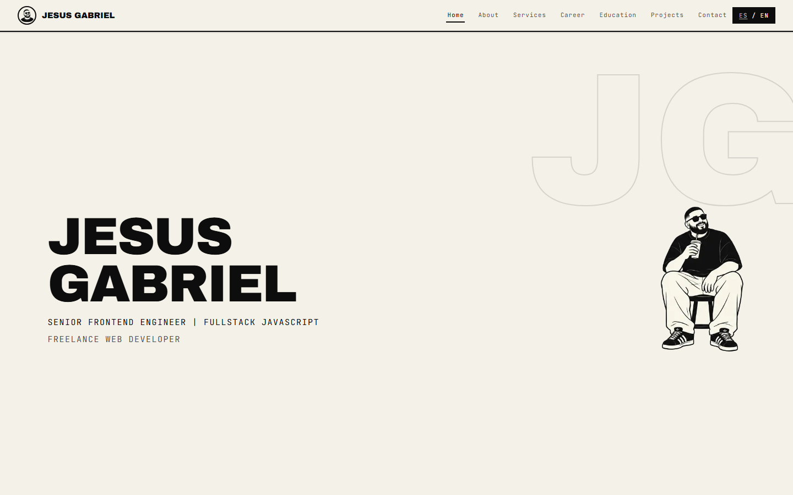
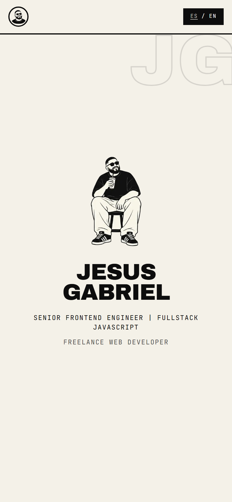
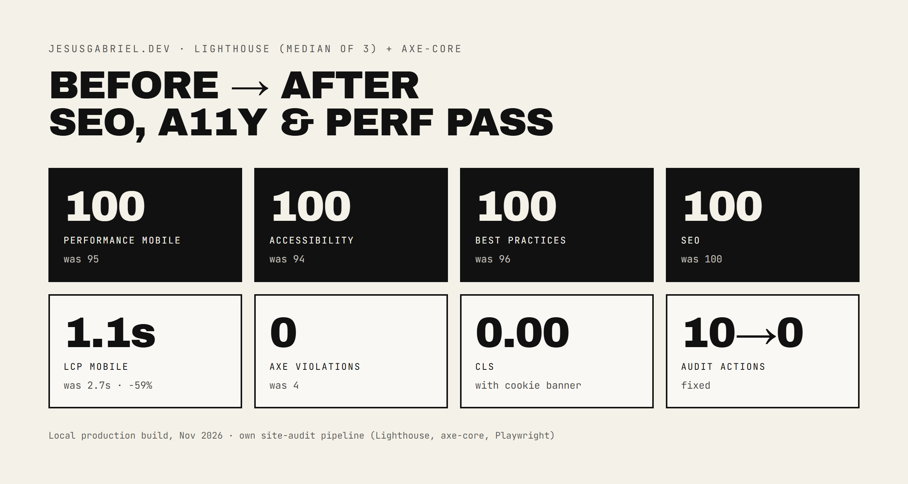

# Jesus Gabriel Ahumada — Portfolio

**[jesusgabriel.dev](https://jesusgabriel.dev)** · Freelance web developer · Senior Frontend Engineer

Personal portfolio built with Next.js 16, Tailwind CSS v4 and Framer Motion. Bilingual (ES/EN) with statically generated routes, a horizontal-scroll experience on desktop and a stacked layout on mobile.

<p align="center">
  
  &nbsp;
  
</p>

## Lighthouse 100 across the board



| Metric | Before | After |
|---|---|---|
| Performance (mobile) | 95 | **100** |
| Performance (desktop) | 100 | **100** |
| Accessibility | 94 | **100** |
| Best practices | 96 | **100** |
| SEO | 100 | **100** |
| LCP (mobile) | 2.7 s | **1.1 s** (−59%) |
| Total Blocking Time (mobile) | 126 ms | **53 ms** |
| CLS | 0.00 | **0.00** |
| axe-core violations (WCAG 2.2 AA) | 4 | **0** |
| Open audit actions | 10 | **0** |

Lab data from a local production build, Lighthouse median of 3 runs, plus axe-core and Playwright keyboard checks. A production run on PageSpeed Insights scores 98–100 on mobile. Measured with my own site-audit pipeline (Nov 2026).

## What's behind the numbers

- **SEO & i18n:** statically generated `/es` and `/en` routes with `hreflang` + `x-default`, canonical per language, a localized sitemap and server-rendered `<html lang>`. `/` redirects based on `Accept-Language`, with Spanish as the default.
- **Structured data:** JSON-LD `Person`, `WebSite` and `ProfessionalService`.
- **Performance:** responsive layout in CSS (no waiting on JS for the first paint), trimmed font weights, no blocking third-party scripts.
- **Accessibility:** `<main>` landmark and skip link, AA contrast, visible focus, keyboard order matching the visual order, 24 px touch targets, `prefers-reduced-motion` respected.
- **Privacy-first analytics:** GA4 with Google Consent Mode v2. `gtag.js` is not downloaded until the visitor accepts, Global Privacy Control is treated as a rejection, and Reject carries the same visual weight as Accept. The privacy policy is in both languages (Colombian Law 1581 and the EU).
- **Real-user monitoring:** LCP, INP and CLS sent to GA4 with `web-vitals`, only with consent.

## Stack

- Next.js 16 (App Router, Turbopack, SSG)
- TypeScript
- Tailwind CSS v4
- Framer Motion
- GA4 + `web-vitals`

## Getting Started

```bash
npm install
npm run dev
```

Open [http://localhost:3000](http://localhost:3000). It redirects to `/es` or `/en`.

## Project Structure

- `src/app/[lang]`: localized layout, metadata, OG image, home and privacy pages
- `src/app/sitemap.ts`, `src/app/robots.ts`: sitemap with language alternates, robots rules
- `src/proxy.ts`: redirects `/` to the preferred language
- `src/components`: `Header`, `HorizontalScroller` (desktop pin-scroll and mobile stack), `ProgressBar`
- `src/components/sections`: one component per section (Hero, About, Services, Career, Education, Projects, Contact)
- `src/components/analytics`, `src/components/consent`: GA4 loader, Web Vitals reporter, cookie banner
- `src/lib/content.ts`: all copy (ES/EN) and section data
- `src/lib/seo-copy.ts`, `src/lib/structured-data.ts`: titles, descriptions and JSON-LD per language

## Editing content

All text lives in `src/lib/content.ts` as bilingual `{ es, en }` objects. No copy is hardcoded in components.

## Deploy

Deployed on [Vercel](https://vercel.com).
